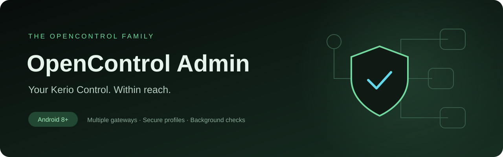
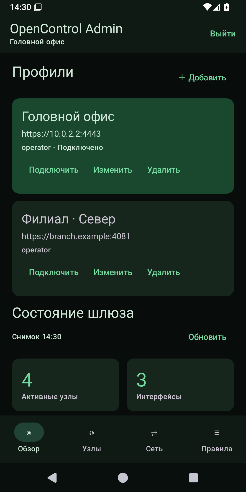
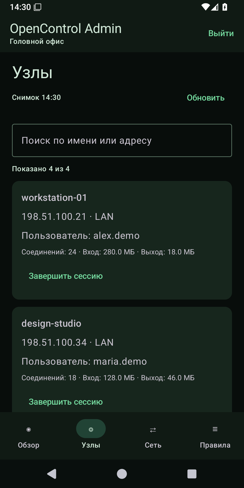
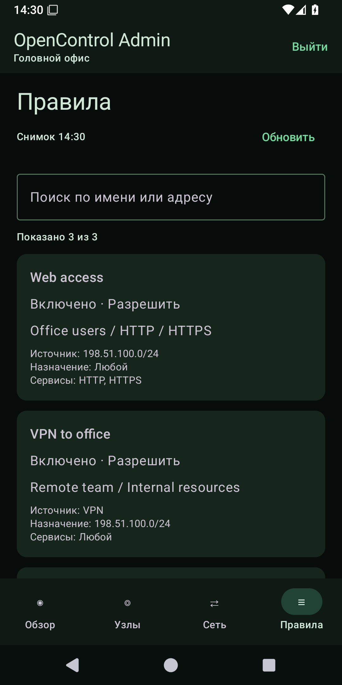
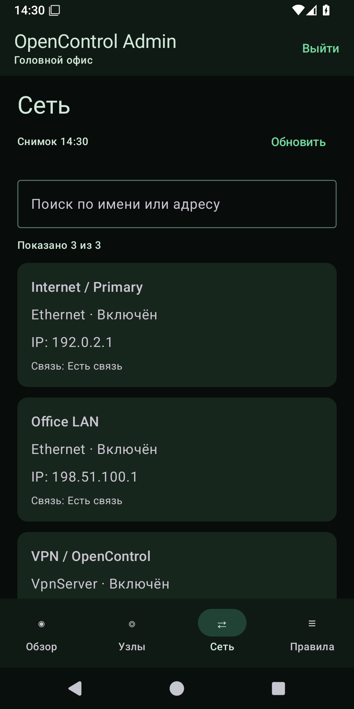
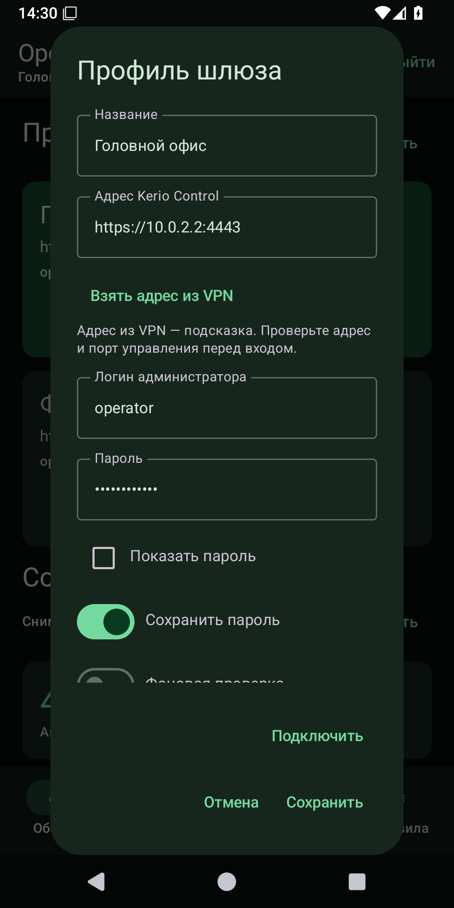
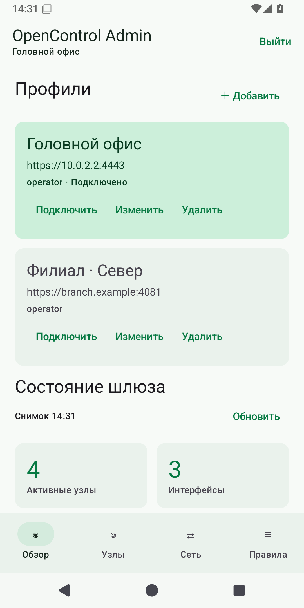

  
  
  

<b>English</b> · <a href="README.md">Русский</a>

<a href="https://github.com/nr084/opencontrol-admin-releases/releases/tag/v0.2"><b>Download for Android</b></a> · <a href="docs/GETTING_STARTED.en.md">Getting started</a> · <a href="https://github.com/nr084/opencontrol-admin-releases/issues">Report an issue</a>

**A mobile administration companion for your existing Kerio Control firewall.** Switch between gateways, inspect active hosts and network interfaces, review traffic rules, and get notified when API connectivity changes — in the familiar green OpenControl design.

This repository hosts public releases, screenshots and documentation. Application source code is maintained privately. **The current app interface is in Russian; this documentation is available in English and Russian.**

**New in 0.2:** an explicit exception for a pinned expired certificate and corrected service names in traffic rules. [Release notes](docs/RELEASE-0.2.md).

## A look inside

<table>
  <tr><td align="center"><b>Your gateways</b></td><td align="center"><b>Active hosts</b></td><td align="center"><b>Traffic rules</b></td></tr>
  <tr>
    <td width="33%"></td>
    <td width="33%"></td>
    <td width="33%"></td>
  </tr>
</table>

Network interfaces, profile settings and light theme

  

Screenshots show the actual Android interface connected to a local synthetic API fixture. All names, accounts and addresses shown are demonstration data. They are not a public Kerio service or a real customer network.

## What you can do

| Feature | In version 0.2 |
| :--- | :--- |
| Multiple profiles | Add, edit, delete and switch between Kerio Control gateways. |
| Secure credentials | Optionally save the password; profile data is encrypted using Android Keystore. |
| VPN address suggestion | Pre-fill an editable address from the available VPN network information. |
| Overview | See the selected gateway and counts of hosts, interfaces and traffic rules. |
| Active hosts | Search hosts, inspect connection counts and traffic totals, and sign out one selected host after confirmation. |
| Network interfaces | Inspect interface addresses and connection state. |
| Traffic rules | Browse and search the existing policy; editing is not available yet. |
| Background checks | Opt in per profile; receive notifications when API login availability changes. |
| Appearance | Light and dark themes following the OpenControl palette. |

## Start in a minute

1. Install the signed APK from [Releases](https://github.com/nr084/opencontrol-admin-releases/releases/tag/v0.2).
2. Connect your VPN if the firewall is only reachable through it.
3. Add a profile, verify the suggested address and enter your administrator credentials. The default management port is **4081**.
4. For a private certificate, verify its SHA-256 fingerprint with your administrator before trusting it.
5. Connect and use **Обзор / Узлы / Сеть / Правила** — Overview / Hosts / Network / Rules.

See the [setup guide](docs/GETTING_STARTED.en.md) for certificate changes, background checks and troubleshooting.

## Before you install

- **Bring your own firewall and access.** The app does not provide a VPN subscription, hosted Kerio instance or administrator account.
- **Early preview.** Android 8.0+ is supported by the build. The UI and signed APK receive emulator checks; broad physical-device and OEM testing is still pending.
- **Background checks are best effort.** Android schedules them approximately every 15 minutes and may defer them in sleep mode. This is not continuous monitoring or a CPU/bandwidth alerting service.
- **Direct OpenControl handoff is planned.** The current VPN client does not yet expose the dedicated gateway provider. The current fallback is an editable suggestion from VPN network information; manual entry may be necessary.
- **Manual refresh.** Screens show the time of the latest snapshot; they are not live streaming dashboards.
- **iOS is planned**, with no iOS build available at present.

## Downloads and verification

Release assets include a signed APK, an Android App Bundle for distribution, and SHA-256 checksums. Install the **APK** on your device; an AAB is not directly installable. This preview is distributed through GitHub, not a Google Play listing.

[Release notes](https://github.com/nr084/opencontrol-admin-releases/releases/tag/v0.2) · [Privacy](docs/PRIVACY.en.md) · [Security reporting](SECURITY.md)

## Feedback

[Open an issue](https://github.com/nr084/opencontrol-admin-releases/issues/new/choose) with the app version, Android version and reproduction steps. Remove passwords, tokens, internal addresses and personal data from attachments.

Independent OpenControl project. Not affiliated with or endorsed by GFI Software. Kerio Control is a trademark of its respective owner.

