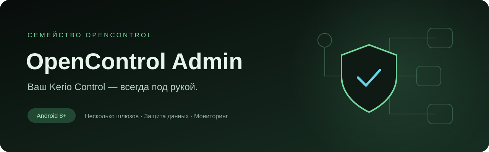

  
  
  

<a href="README.md">English</a> · <b>Русский</b>

<a href="https://github.com/nr084/opencontrol-admin-releases/releases/tag/v0.1.0"><b>Скачать для Android</b></a> · <a href="docs/GETTING_STARTED.ru.md">Начало работы</a> · <a href="https://github.com/nr084/opencontrol-admin-releases/issues">Сообщить об ошибке</a>

**Мобильный помощник администратора вашего Kerio Control.** Переключайтесь между шлюзами, смотрите активные узлы и сетевые интерфейсы, изучайте правила трафика и получайте уведомления об изменении доступности API — в знакомом зелёном оформлении OpenControl.

Здесь размещены публичные релизы, скриншоты и документация. Исходный код приложения хранится приватно. **Интерфейс текущей версии — на русском; документация доступна на русском и английском.**

## Как это выглядит

<table>
  <tr><td align="center"><b>Ваши шлюзы</b></td><td align="center"><b>Активные узлы</b></td><td align="center"><b>Правила трафика</b></td></tr>
  <tr>
    <td width="33%"></td>
    <td width="33%"></td>
    <td width="33%"></td>
  </tr>
</table>

Сетевые интерфейсы, настройки профиля и светлая тема

  

На скриншотах — настоящий интерфейс Android-приложения с локальным имитатором API. Имена, учётные записи и адреса вымышлены. Это не открытый сервер Kerio и не корпоративная сеть пользователя.

## Возможности

| Функция | В версии 0.1.0 |
| :--- | :--- |
| Несколько профилей | Добавление, редактирование, удаление и переключение шлюзов Kerio Control. |
| Защита учётных данных | Сохранение пароля по желанию; шифрование профиля средствами Android Keystore. |
| Подсказка адреса VPN | Редактируемый адрес по доступной информации о VPN-сети. |
| Обзор | Выбранный шлюз и количество узлов, интерфейсов и правил. |
| Активные узлы | Поиск, число соединений, объёмы трафика и завершение сессии одного узла с подтверждением. |
| Сетевые интерфейсы | Просмотр адресов и состояния связи. |
| Правила трафика | Просмотр и поиск существующих правил; редактирование пока недоступно. |
| Фоновая проверка | Включение отдельно для каждого профиля; уведомления об изменении доступности входа в API. |
| Оформление | Светлая и тёмная темы в палитре OpenControl. |

## Начало работы

1. Установите подписанный APK из [раздела Releases](https://github.com/nr084/opencontrol-admin-releases/releases/tag/v0.1.0).
2. Подключите VPN, если шлюз доступен только через него.
3. Добавьте профиль, проверьте предложенный адрес и введите учётные данные администратора. Порт управления по умолчанию — **4081**.
4. Для частного сертификата сверьте SHA-256 с администратором и подтвердите доверие.
5. Подключитесь и откройте нужную вкладку: **Обзор / Узлы / Сеть / Правила**.

Смена сертификата, фоновые проверки и решение проблем описаны в [инструкции](docs/GETTING_STARTED.ru.md).

## Перед установкой

- **Нужны свой firewall и доступ к нему.** Приложение не предоставляет VPN-подписку, сервер Kerio или аккаунт администратора.
- **Ранняя предварительная версия.** Сборка поддерживает Android 8.0+. Интерфейс и подписанный APK проверяются в эмуляторе; широкое тестирование на физических устройствах ещё предстоит.
- **Фоновая проверка не непрерывная.** Android запускает её примерно раз в 15 минут и может откладывать в режиме сна. Контроль CPU, полосы канала и пороговые оповещения пока не реализованы.
- **Прямая передача адреса из OpenControl запланирована.** Текущий VPN-клиент ещё не предоставляет специальный provider. Сейчас используется редактируемая подсказка из параметров VPN; иногда адрес нужно ввести вручную.
- **Обновление вручную.** На экране указано время последнего снимка данных; потокового обновления нет.
- **iOS — в планах**, готовой сборки пока нет.

## Загрузка и проверка

В релизе доступны подписанный APK, Android App Bundle для распространения и контрольные суммы SHA-256. На телефон устанавливается **APK**; AAB не предназначен для прямой установки. Предварительная версия распространяется через GitHub, а не через Google Play.

[Заметки к релизу](https://github.com/nr084/opencontrol-admin-releases/releases/tag/v0.1.0) · [Конфиденциальность](docs/PRIVACY.ru.md) · [Сообщения об уязвимостях](SECURITY.md)

## Обратная связь

[Создайте issue](https://github.com/nr084/opencontrol-admin-releases/issues/new/choose), указав версию приложения, Android и шаги воспроизведения. Удалите из вложений пароли, токены, внутренние адреса и персональные данные.

Независимый проект OpenControl. Не связан с GFI Software и не заявляет об одобрении со стороны GFI. Kerio Control — товарный знак соответствующего правообладателя.
